# 🥽 ReOculus

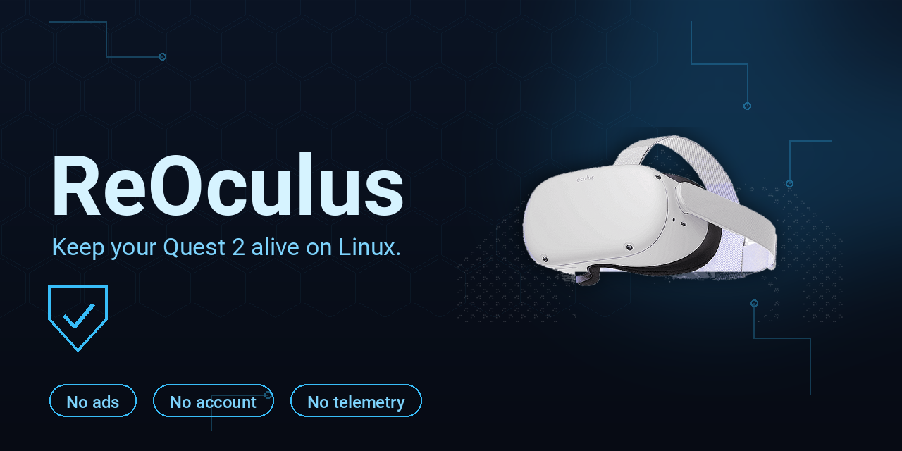

**Your Quest 2 or Quest 1, on Linux, without the nonsense. No ads. No account. No telemetry. Nothing leaves your computer.**

ReOculus is a companion app for the Meta Quest 2, Quest 1 (and 3) that replaces the Meta PC app and SideQuest for everyday stuff: manage your apps, back them up, poke around the files, mirror the screen, and run PC VR on Linux with WiVRn. All over USB or Wi-Fi.

Why? Meta is winding down Quest 2 support (last features in Horizon OS v2.13, March 2027, security patches until December 2027). This is my way of keeping the old headset useful on Linux long after that.

> Yes, I used AI to help design and code this. It works on my own Quest 2, every day. If it breaks for you, tell me and we will fix it.

[⬇️ Download](#-download) · [✨ What it does](#-what-it-does) · [📸 Screenshots](#-screenshots) · [🚀 First run](#-first-run) · [🖥️ PC VR](#️-pc-vr) · [🔧 Build it yourself](#-build-it-yourself) · [📋 Status](#-status) · [⚖️ License and credits](#️-license-and-credits)

   

## ✨ What it does

| | Area | What you get |
| --- | --- | --- |
| 📱 | **Apps** | List, search, launch, install (APK/APKS/XAPK), uninstall, force stop, clear data. Real icons and sizes, List or Tiles view. |
| 💾 | **Backups** | Full app backup (APK + data when rooted), save-only backup, one-tap restore from the Library, with a dry run first so nothing surprises you. |
| 📂 | **Files** | Browse the headset storage, upload, download, delete. |
| 🪞 | **Mirror** | Live screen mirror over USB or Wi-Fi (scrcpy, quality per connection, and it restarts itself when a game or the menu opens). Screenshot and on-device video recording. |
| 🎛️ | **Device** | Battery, storage, firmware, controllers, refresh rate and performance settings. Rooted-only settings live in their own section, out of the way. |
| 🖥️ | **PC VR** | WiVRn 26.9 wrapper: start/stop the server, encoder and codec picker, headset client version check. The server rides along inside the AppImage, and the headset app installs itself on first connect. |
| 📚 | **Library** | One folder on your computer holds every backup and imported APK. |
| 📖 | **Offline help** | The whole help section works with no internet. |

## 📸 Screenshots

Every screen, rendered from the app's own widget tests with Lorem Ipsum placeholder data, so you can see what it looks like without a headset plugged in. No real data in any of them.

### Home

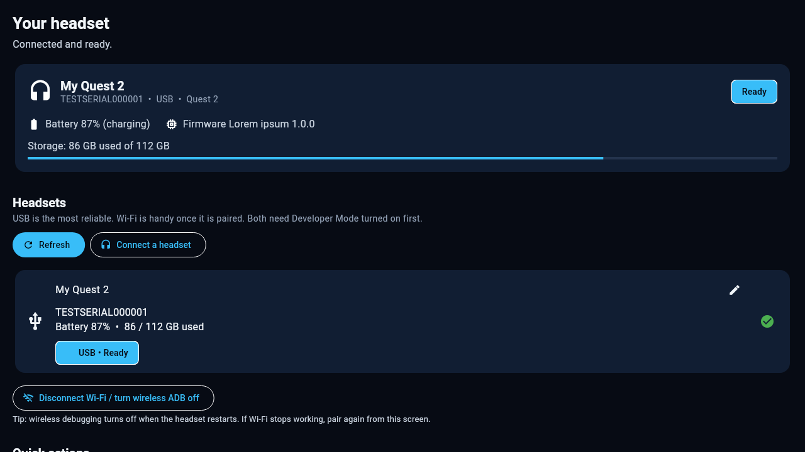

The Headsets list (USB + Wi-Fi folded into one card per headset) lives on Home now, so there is no separate Devices page. The screenshot below shows one headset on USB and Wi-Fi at once, with the note that the cable can come out.

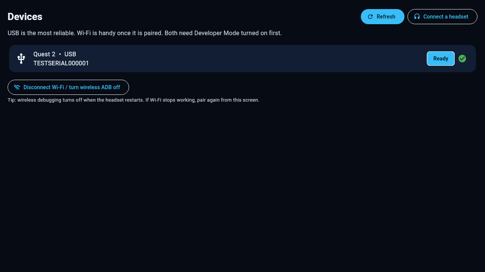

### Apps, list and tiles

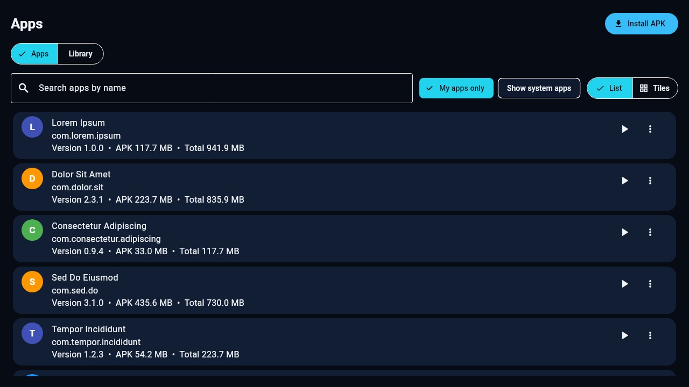

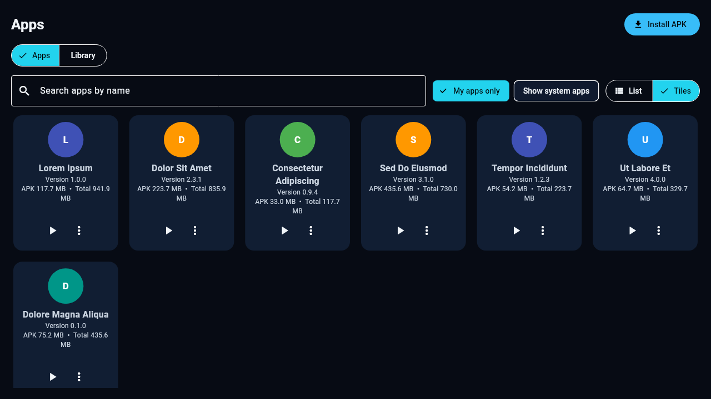

### Files

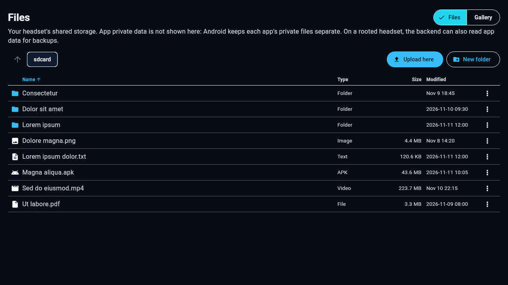

### Device and settings

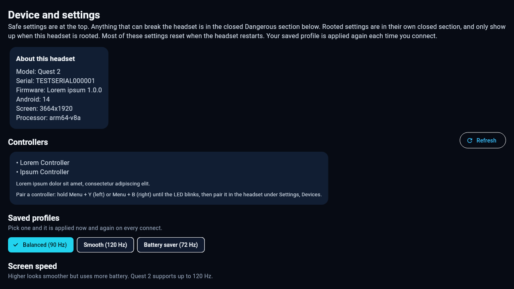

### Mirror

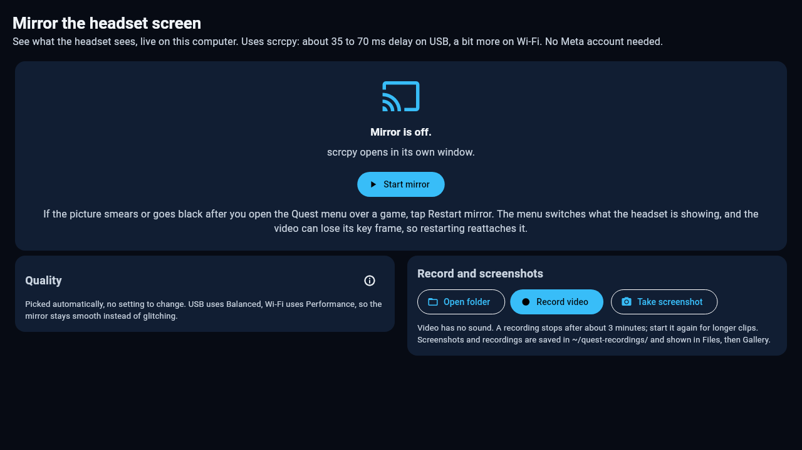

### PC VR (WiVRn)


### PC VR games and apps

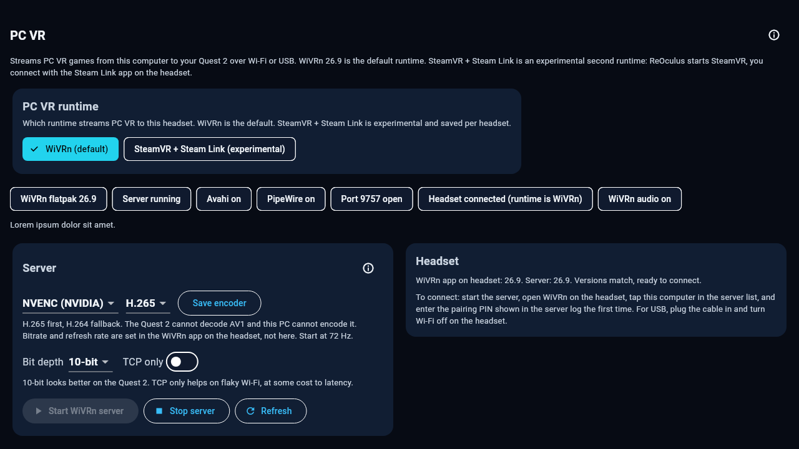

### PC VR settings


### Logs

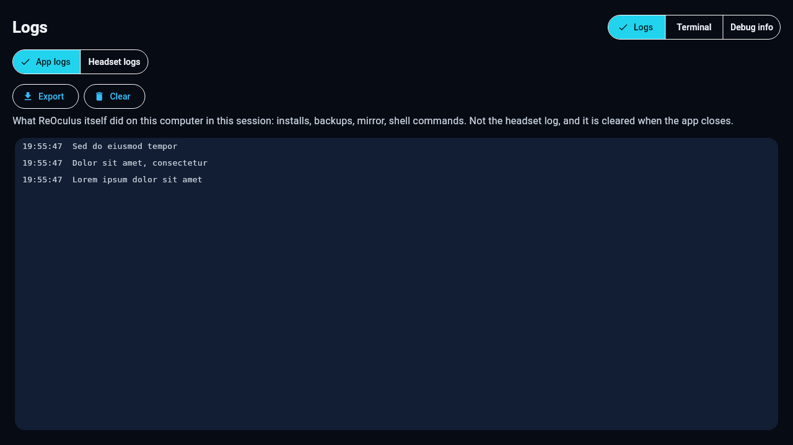

### Help

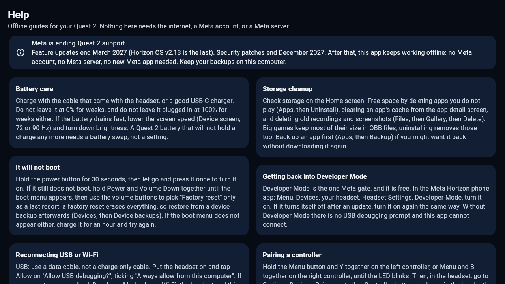

### Setup

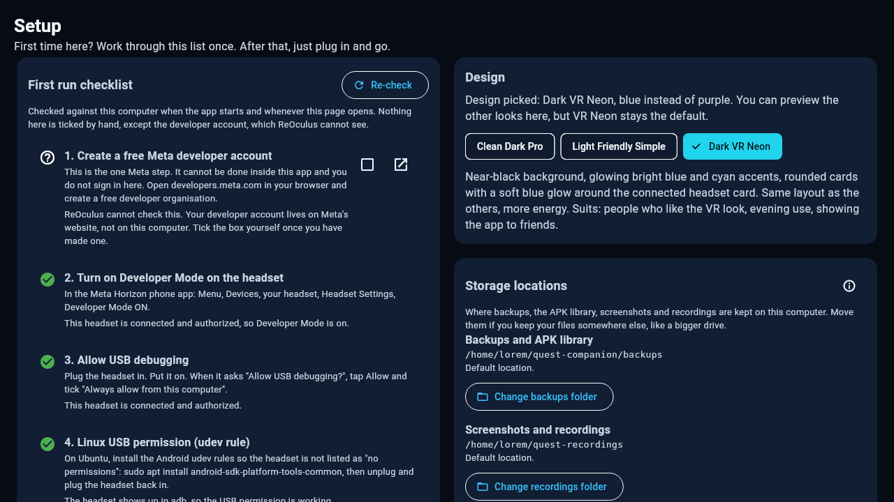

### Singularity root wizard

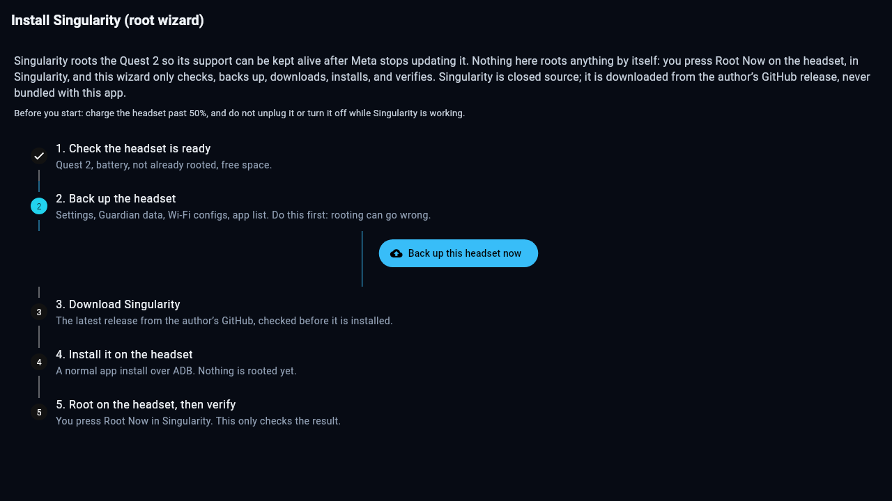

## ⬇️ Download

Grab the latest AppImage from the [Releases](../../releases) page and run it:

```sh
chmod +x ReOculus-*.AppImage
./ReOculus-*.AppImage
```

That is the whole install. The AppImage carries the app **and** the `questctl` backend **and** the WiVRn 26.9 server, so there is nothing else to set up. One note: WiVRn installs through Flatpak on first use, so the PC needs Flatpak. The KDE runtime comes from Flathub the first time if it is not already there.

The Android APK is a full UI preview for now. Headset features on Android are not ready yet, the Rust backend still has to be embedded (see [Android transport](#android-transport)).

## 🚀 First run

1. **Developer Mode on.** Free Meta developer account, flip the toggle in the Meta Horizon phone app. That is the only step that touches Meta at all.
2. **Plug in and connect.** Tap **Connect with USB**, or **Connect with Wi-Fi**. The app sets up wireless ADB itself, so you can unplug after the first USB connection.
3. **PC VR, if you want it.** The first time a headset connects, the app asks about setting up PC VR. It installs the WiVRn server from the bundled file, installs the WiVRn app on the headset, and sets up the USB and Wi-Fi links. After that it is just **Start** on the PC VR screen and tap the computer in the headset app. Say **Not now** and the PC VR section greys out, with an **Install WiVRn** button that reopens the same setup whenever you are ready.

## 🔌 How it works

```
Flutter UI (Linux + Android)
        |
        |  one JSON object per call
        v
questctl  (Rust, quest-core)  --  spawned system adb / libadb DirectTransport
        |
        v
Meta Quest 2 / 3  (USB adb, Wi-Fi adb)
```

- **No Meta APIs, no SideQuest APIs, no account, no network calls** to anyone. The only thing that ever leaves the computer is whatever you explicitly download (the WiVRn APK from GitHub Releases, on first setup).
- **Backend:** Rust workspace in `backend/`, a `quest-core` library plus the `questctl` CLI. Every command prints one JSON object, `{"ok": true, ...}` or `{"ok": false, "error": "..."}`. The exact interface is in [`backend/CONTRACT.md`](backend/CONTRACT.md).
- **UI:** Flutter in `flutter_app/`. Dark VR Neon, blue. Near-black blue background, bright blue accent. Other themes are in the code if you want to play with them.
- **Streaming:** [scrcpy](https://github.com/Genymobile/scrcpy) for the mirror, on-device `screenrecord` for video recording.
- **PC VR:** [WiVRn 26.9](https://github.com/WiVRn/WiVRn), an OpenXR runtime and streamer built on Monado. The app drives the unmodified server (config file + process + `wivrnctl` + polling). It does not fork or embed WiVRn.

## 🖥️ PC VR

Short version: it streams PC VR games from this computer to the headset over Wi-Fi or USB, Linux only, no Windows, no SteamVR. The server and the headset app have to be the same version (26.9), and the app checks that for you and tells you plainly if they do not match.

Start at 72 Hz, H.265, NVENC if you have an NVIDIA card. Bitrate and refresh rate are set in the WiVRn app on the headset, not here, that is where they actually live.

## 🔧 Build it yourself

### Backend

```sh
cd backend
cargo test --release
cargo build --release
```

### Linux app

```sh
cd flutter_app
flutter pub get
flutter build linux --release
```

Package an AppImage with `scripts/build-appimage.sh` (see the script header for paths). It copies the Flutter bundle, `questctl`, and the bundled `wivrn-server.flatpak` into the AppDir. The WiVRn bundle itself is fetched by `scripts/fetch-wivrn.sh` and is not stored in git (about 7 MB of upstream binary).

### Android

```sh
cd flutter_app
flutter build apk --release
```

## 🤖 Android transport

The APK now works on Android over Wi-Fi: it bundles the `questctl` binary built for Android aarch64 and talks to the headset with the libadb direct transport, so the same headset features work from a phone. PC VR is hidden on Android, because no phone can host VR streaming for a Quest. If you know that piece, contributions are very welcome.

## 📋 Status

**0.2.35** (2026-11-15): The PC mirror has a built-in option now, no scrcpy needed. The Mirror screen has a method switch: scrcpy (default, 35 to 70 ms, its own window) or Built-in stream (the same H.264 stream the Android app uses, decoded inside the app window with the system's ffmpeg libraries, loaded at runtime so the AppImage stays small; without ffmpeg installed it says so and scrcpy still works, about a second behind, restarts every 3 minutes). The choice is saved per computer in the mirror settings (`mirror-settings set --method scrcpy|builtin`). The Android live view is unchanged.

**0.2.34** (2026-11-15): Mirror works on Android now. The Android app is for people without a PC, so the mirror has to work there too, and it does: questctl streams the headset display as raw H.264 with a new `device mirror-stream` command (screenrecord at 1280x720 over the direct transport, restarted every 3 minutes because screenrecord caps at 180 s per run), and the app decodes it on the device with MediaCodec into a Flutter texture on the Mirror screen. It is view only, about a second behind, and the picture restarts itself every 3 minutes with a brief black gap. The backend gained a streaming shell for both transports (`shell_stream`, frames as they arrive instead of collected output) to carry it. Linux is unchanged, still scrcpy with its presets and watcher.

**0.2.33** (2026-11-15): The Android app can connect now. 0.2.32 failed on first connect with "Permission denied" because Android 10 and later refuse to run a binary out of the app's writable files dir, even with the execute bit set. The bundled questctl now ships as a native library (libquestctl.so in the APK's lib/arm64-v8a, installed to the app's native library dir, which is made to be run from), found through a small channel in MainActivity, with the old extracted copy kept as a fallback for devices without it. No backend changes.

**0.2.32** (2026-11-14): The Setup checklist checks itself now. Every box is detected from the real system instead of ticked by hand: the udev box is done when android-sdk-platform-tools-common is installed or a udev rule covering Meta devices (vendor 2833) is found, or when a headset shows up in adb at all, and a headset showing as no permissions means not done even with the package installed. Developer Mode and USB debugging come from adb devices: a connected and authorized headset means both are done, a headset waiting for the Allow tap means Developer Mode is on but debugging is not allowed yet, and no headset plugged in means unknown, not undone. The check runs when the app starts and whenever the Setup page opens, plus a Re-check button, and each box shows the reason or the evidence under it. The developer account is the one box ReOculus cannot check, it lives on Meta's website, so that one stays manual and says so. This also fixes two boxes sharing one tick, which used to tick both at once.

**0.2.31** (2026-11-14): The PC Games/Apps list can be edited now. Every game has a pencil next to the trash can: it opens the same dialog as Add, with the name, executable, launch options, icon and description already filled in. Launch options are extra command line options after the executable, for example --fullscreen. The icon is a png, jpg, svg or xpm image you pick with Browse, shown as a thumbnail next to the game, and empty means the default game icon. The description is a one-line note. Editing keeps the same .desktop file, only the fields change, and the backend checks the new executable exists, has no spaces in its path, and that an icon file path is real.

**0.2.30** (2026-11-14): Files is a proper file manager now, like Windows Explorer or Dolphin. The chunky tiles are gone: one dense row per file with name, type, size and last-modified date, and tapping a column header sorts by it. Drag and drop works both ways on Linux: drag files in from your file manager to upload them here (whole folders keep their structure, and it asks before overwriting), and drag a file out to your file manager to download it. Dragging out pulls the file to this computer first, because Linux needs the file to exist before a drag can start, so a big file takes a moment before the drag begins. Those staged files are cleaned up by age (7 days) and size (1 GB cap). No backend changes: this build uses the push, pull and mkdir commands that were already there.

**0.2.29** (2026-11-14): SteamVR + Steam Link is a second PC VR runtime, experimental and opt-in per headset. The PC VR screen has a runtime picker now: WiVRn stays the default, and picking SteamVR shows a readiness check first (native vs Flatpak Steam, SteamVR version 2.18 or newer, NVIDIA driver 575.64.05 or newer, whether WiVRn is in the way), each problem with its fix. Starting SteamVR stops WiVRn first and snapshots the shared runtime config, restored when SteamVR stops. ReOculus only starts SteamVR through Steam, it never installs, bundles, or changes it, and you connect with the free Steam Link app on the headset. Heads up: Steam Link on this PC's GTX 1050 Ti is untested, video may fail to start, and the screen says so. SteamVR is not installed on this PC yet, so the first thing the screen will tell you is to install it in Steam.

**0.2.28** (2026-11-13): The About card on Device and settings was one long stacked list in a tall empty card. The info is spread out across the card now: Headset, Display, Battery, Storage, and Processor sit side by side, 3 across on a wide window, 2 on a medium one, 1 on a narrow one. This build also has the 0.2.27 fix, the rename pencil on a headset's card sits next to the name now instead of at the far right edge.

**0.2.27** (2026-11-13): Built but never sent out, superseded by 0.2.28 before delivery. The pencil to rename a headset on the Headsets card used to sit at the far right edge of the card, away from the name. It is next to the name now, right where you would look for it.

**0.2.26** (2026-11-13): The Android app works now, over Wi-Fi. It bundles the same backend the Linux app uses, built for a phone, so you can manage your headset from your phone on the same Wi-Fi: connect with the headset IP, port 5555, and no pairing code if the headset already listens on the old wireless debugging port. The first connect shows an "Allow USB debugging?" prompt in the headset for the phone's key, tap Allow. There is also a new headset config file: the app writes a plain text file called headset.cfg right on the headset (in /sdcard/ReOculus/), with just your custom headset name in it, so Linux and Android show the same name. Everything else, settings and apps, the app reads live from the headset, so there is nothing to sync by hand. Rename from the little pencil on the headset's card and it sticks everywhere. Small fix too: the storage bar looked full when it was not, because the empty part of the bar was bright cyan. It is dim slate now, so 88 of 112 GB reads as 88 of 112 GB. The Devices page is gone, folded into Home as the Headsets list: when the same headset is on USB and Wi-Fi at once you get one card, with a chip for each connection and a note that you can unplug the cable. Recent activity moved to Logs, under App logs. Files is a real file manager now, with dates, rename, delete for folders too, and a New folder button. The About card on Device and Settings shows more now, battery health, temperature, voltage, screen density, free space, in neat labelled rows. The Linux side got a few things in the same build: the Library shows real app icons now (read from the APKs already on your computer, no headset pull), Homes is redone as a Home launcher section with a dropdown to get Lightning Launcher, Setup has a Support Countdown card with the end-of-support dates for Quest 1 and Quest 2, Logs split into App logs and Headset logs, and the Apps tiles are back to the old layout, smaller and more square.

**0.2.25** (2026-11-13): Quest 1 support, because people on Reddit asked for it. The app now tells you which headset is connected (Quest 1 is codename monterey, Quest 2 is hollywood) and shows it by name on the Home and Device and Settings screens. On a Quest 1, Singularity and Quest Home Switcher are hidden: Singularity only supports Quest 2, Pro, 3, and 3S, and Quest Home Switcher only lists Quest 2 / 3 / 3S. Everything else works: Lightning Launcher, WiVRn, apps, files, backups, mirror, and settings, with the refresh rate capped at 72 Hz and the mirror using h264 instead of h265. The Home apps card moved out of the Rooted section so it shows without root. One caveat: no literal Quest 1 getprop dump is published anywhere, so the monterey / Quest strings are inferred from the Quest 2/3 pattern and still need confirming on a real Quest 1.

**0.2.24** (2026-11-12): Licensing and credits are done properly now, and the app says so plainly. CREDITS.md lists every dependency with its licence: all ten Rust crates, the Flutter packages, WiVRn GPLv3 with the exact v26.9 source tag, Frida, scrcpy, and the rest. Cargo.lock is tracked in git now so the exact dependency set is pinned, and the full GPLv3 text ships in the repo under licenses/. The AppImage carries LICENSE, CREDITS.md, and the GPLv3 text inside it, and the About page in the app now says use it at your own risk, I am not responsible for anything that happens.

**0.2.23** (2026-11-12): The PC VR screen can add your own games and apps now, and it can change WiVRn's settings. PC Games/Apps is a new collapsible section: pick any executable with Browse and it shows in the WiVRn launcher on the headset, and it can be removed again from the same list. Open Saber, added this way, showed up in the headset and booted, so the Flatpak server does see entries in your home folder. WiVRn settings is another collapsible section: bitrate, picture quality, refresh rate, codec, bit depth, passthrough, foveated rendering and the rest are read from the headset's WiVRn settings file and written back over adb, and the server card now has bit depth and a TCP-only switch too. Also fixed: the server used to fail to start from the app because Flatpak expected a document-portal folder that did not exist yet, and the error blamed Avahi even when Avahi was running. The backend makes the folder first, and the Avahi hint only shows when the server really exits with code 4.

**0.2.22** (2026-11-12): The auto-restart waits for the picture to settle now. It used to restart the moment the app in front changed, which sometimes landed while the menu was still opening or closing, so the new stream started mid-transition and smeared again. Now it only restarts once the app in front has been unchanged for a couple of seconds, and the gap between restarts is 5 seconds instead of 10, so the restart after closing the menu comes sooner. Restart mirror also waits 2 seconds after stopping before it starts again, for the same reason.
**0.2.21** (2026-11-12): The mirror restarts itself now. When a game or the Quest menu opens, the picture used to smear and stall; a watcher on this computer checks which app is in front about once a second and restarts scrcpy when it changes, so the mirror comes back clean after a second or two of black. It is on by default and there is a switch on the Mirror screen to turn it off. It also brings the mirror back if scrcpy dies on its own, and it never restarts more than once every 10 seconds.
**0.2.20** (2026-11-12): Mirror quality is changeable now, one preset for USB and one for Wi-Fi, with the old automatic picks (USB Balanced, Wi-Fi Performance) as the defaults. Device and Settings groups its cards under category headers (Display and speed, Backups, Home, Health) and the two-cards-per-row spacing is fixed, short cards no longer leave gaps under them. Headset Health has a Battery and usage history block: battery levels the app records each time it checks the headset, and the most-used apps from the headset's own usage stats.
**0.2.19** (2026-11-12): Home apps in the Rooted section: Lightning Launcher 10.0.1 and Quest Home Switcher 2.3.0 install, update, and open from the app, with the headset scanned for what is installed and whether an update is out; the QHS card has its own Browse custom homes button (the 250-home catalogue lives inside QHS). The Homes list shows only real launchers now (the stock home and the Settings fallback are gone from it), with Open once, Open Meta Home once, and buttons that open settings screens on the headset. The PC app can also change where backups, the library, screenshots, and recordings live (Setup, Storage locations). "Battery and health" is now "Headset Health" and holds the controllers too: when both controllers are asleep the card shows the last ones seen and when, instead of looking broken. Pages are condensed to two cards per row on a wide window (Files and Apps keep their own layouts). The default home still cannot be changed directly on this firmware: the headset refuses the switch command and the HOME role change, even as root, and there is no editable home setting in the system files, so the app opens homes on demand and offers the headset's Home settings picker instead.

**0.2.18** (2026-11-12): Singularity downloads and rooted settings in the Rooted section: the Singularity APK, the Frida server (17.17.0), and the Meta domain blocklist (74 domains) download from Singularity's own GitHub repo, with install, push, start/stop, and apply/remove on the headset; the update pause is now a real toggle (it points the update server at the headset itself, the updater app is left alone); dock and home settings (battery percent, hiding dock buttons) as switches, with a Restart home UI button. Pages also got small "i" info buttons on the sections people ask about. The app is now called ReOculus. See the [Releases](../../releases) page for each version's notes.

## ⚖️ License and credits

This project's own code is **MIT**. See [LICENSE](LICENSE) and [CREDITS.md](CREDITS.md) for the full list: WiVRn (GPLv3, bundled server only), scrcpy (Apache 2.0), SideQuest (reference only, no code used), and the other projects this app is built on or learned from.

## ⚠️ Use at your own risk

ReOculus talks to your headset over ADB. It can change settings, install and remove apps, back up and delete files, and block updates. That is the whole point of it, and it is also why you should back up anything you care about before you let it loose.

This software is provided as is, with no warranty of any kind. I am not responsible for anything that happens if you use it: a bricked headset, lost saves, a wiped install, an account problem, or anything else. If you are not comfortable with that, do not run it.
