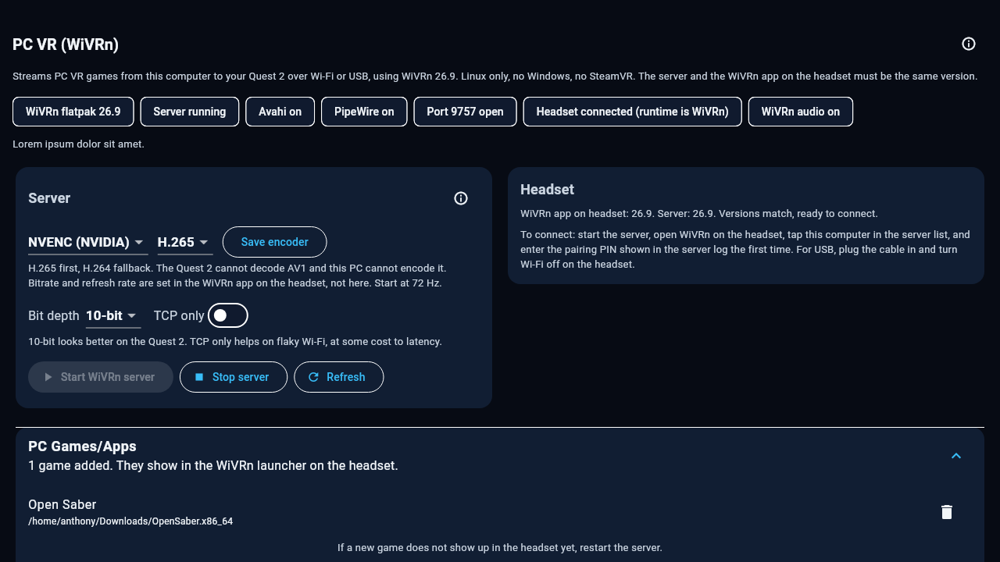
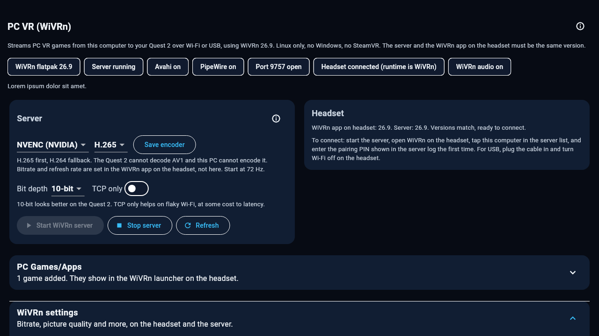
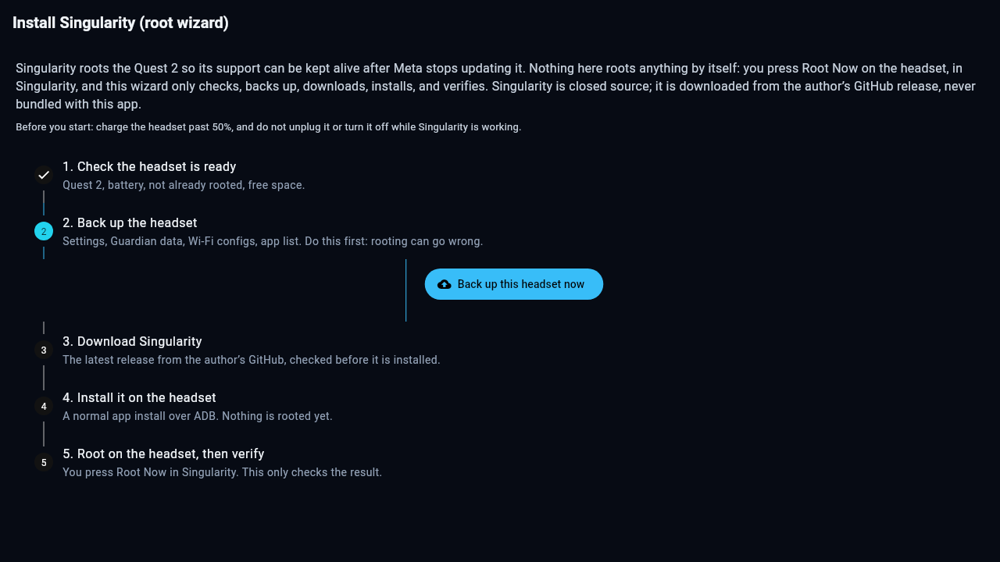

# 🥽 ReOculus


**Your Quest 2, on Linux, without the nonsense. No ads. No account. No telemetry. Nothing leaves your computer.**

ReOculus is a companion app for the Meta Quest 2 (and 3) that replaces the Meta PC app and SideQuest for everyday stuff: manage your apps, back them up, poke around the files, mirror the screen, and run PC VR on Linux with WiVRn. All over USB or Wi-Fi.

Why? Meta is winding down Quest 2 support (last features in Horizon OS v2.13, March 2027, security patches until December 2027). This is my way of keeping the old headset useful on Linux long after that.

> Yes, I used AI to help design and code this. It works on my own Quest 2, every day. If it breaks for you, tell me and we will fix it.

[⬇️ Download](#-download) · [✨ What it does](#-what-it-does) · [📸 Screenshots](#-screenshots) · [🚀 First run](#-first-run) · [🖥️ PC VR](#️-pc-vr) · [🔧 Build it yourself](#-build-it-yourself) · [📋 Status](#-status) · [⚖️ License and credits](#️-license-and-credits)

   

## ✨ What it does

| | Area | What you get |
| --- | --- | --- |
| 📱 | **Apps** | List, search, launch, install (APK/APKS/XAPK), uninstall, force stop, clear data. Real icons and sizes, List or Tiles view. |
| 💾 | **Backups** | Full app backup (APK + data when rooted), save-only backup, one-tap restore from the Library, with a dry run first so nothing surprises you. |
| 📂 | **Files** | Browse the headset storage, upload, download, delete. |
| 🪞 | **Mirror** | Live screen mirror over USB or Wi-Fi (scrcpy, quality per connection, and it restarts itself when a game or the menu opens). Screenshot and on-device video recording. |
| 🎛️ | **Device** | Battery, storage, firmware, controllers, refresh rate and performance settings. Rooted-only settings live in their own section, out of the way. |
| 🖥️ | **PC VR** | WiVRn 26.9 wrapper: start/stop the server, encoder and codec picker, headset client version check. The server rides along inside the AppImage, and the headset app installs itself on first connect. |
| 📚 | **Library** | One folder on your computer holds every backup and imported APK. |
| 📖 | **Offline help** | The whole help section works with no internet. |

## 📸 Screenshots

Every screen, rendered from the app's own widget tests with Lorem Ipsum placeholder data, so you can see what it looks like without a headset plugged in. No real data in any of them.

### Home


### Devices


### Apps, list and tiles


### Files


### Device and settings


### Mirror


### PC VR (WiVRn)


### PC VR games and apps



### PC VR settings



### Logs


### Help


### Setup


### Singularity root wizard



## ⬇️ Download

Grab the latest AppImage from the [Releases](../../releases) page and run it:

```sh
chmod +x ReOculus-*.AppImage
./ReOculus-*.AppImage
```

That is the whole install. The AppImage carries the app **and** the `questctl` backend **and** the WiVRn 26.9 server, so there is nothing else to set up. One note: WiVRn installs through Flatpak on first use, so the PC needs Flatpak. The KDE runtime comes from Flathub the first time if it is not already there.

The Android APK is a full UI preview for now. Headset features on Android are not ready yet, the Rust backend still has to be embedded (see [Android transport](#android-transport)).

## 🚀 First run

1. **Developer Mode on.** Free Meta developer account, flip the toggle in the Meta Horizon phone app. That is the only step that touches Meta at all.
2. **Plug in and connect.** Tap **Connect with USB**, or **Connect with Wi-Fi**. The app sets up wireless ADB itself, so you can unplug after the first USB connection.
3. **PC VR, if you want it.** The first time a headset connects, the app asks about setting up PC VR. It installs the WiVRn server from the bundled file, installs the WiVRn app on the headset, and sets up the USB and Wi-Fi links. After that it is just **Start** on the PC VR screen and tap the computer in the headset app. Say **Not now** and the PC VR section greys out, with an **Install WiVRn** button that reopens the same setup whenever you are ready.

## 🔌 How it works

```
Flutter UI (Linux + Android)
        |
        |  one JSON object per call
        v
questctl  (Rust, quest-core)  --  spawned system adb / libadb DirectTransport
        |
        v
Meta Quest 2 / 3  (USB adb, Wi-Fi adb)
```

- **No Meta APIs, no SideQuest APIs, no account, no network calls** to anyone. The only thing that ever leaves the computer is whatever you explicitly download (the WiVRn APK from GitHub Releases, on first setup).
- **Backend:** Rust workspace in `backend/`, a `quest-core` library plus the `questctl` CLI. Every command prints one JSON object, `{"ok": true, ...}` or `{"ok": false, "error": "..."}`. The exact interface is in [`backend/CONTRACT.md`](backend/CONTRACT.md).
- **UI:** Flutter in `flutter_app/`. Dark VR Neon, blue. Near-black blue background, bright blue accent. Other themes are in the code if you want to play with them.
- **Streaming:** [scrcpy](https://github.com/Genymobile/scrcpy) for the mirror, on-device `screenrecord` for video recording.
- **PC VR:** [WiVRn 26.9](https://github.com/WiVRn/WiVRn), an OpenXR runtime and streamer built on Monado. The app drives the unmodified server (config file + process + `wivrnctl` + polling). It does not fork or embed WiVRn.

## 🖥️ PC VR

Short version: it streams PC VR games from this computer to the headset over Wi-Fi or USB, Linux only, no Windows, no SteamVR. The server and the headset app have to be the same version (26.9), and the app checks that for you and tells you plainly if they do not match.

Start at 72 Hz, H.265, NVENC if you have an NVIDIA card. Bitrate and refresh rate are set in the WiVRn app on the headset, not here, that is where they actually live.

## 🔧 Build it yourself

### Backend

```sh
cd backend
cargo test --release
cargo build --release
```

### Linux app

```sh
cd flutter_app
flutter pub get
flutter build linux --release
```

Package an AppImage with `scripts/build-appimage.sh` (see the script header for paths). It copies the Flutter bundle, `questctl`, and the bundled `wivrn-server.flatpak` into the AppDir. The WiVRn bundle itself is fetched by `scripts/fetch-wivrn.sh` and is not stored in git (about 7 MB of upstream binary).

### Android

```sh
cd flutter_app
flutter build apk --release
```

## 🤖 Android transport

The APK today is the full UI, but headset features do not work on Android yet: there is no `questctl` binary to spawn there. The plan is to bundle `questctl` built for Android aarch64 and use the existing libadb DirectTransport over Wi-Fi. If you know that piece, contributions are very welcome.

## 📋 Status

**0.2.23** (2026-11-12): The PC VR screen can add your own games and apps now, and it can change WiVRn's settings. PC Games/Apps is a new collapsible section: pick any executable with Browse and it shows in the WiVRn launcher on the headset, and it can be removed again from the same list. Open Saber, added this way, showed up in the headset and booted, so the Flatpak server does see entries in your home folder. WiVRn settings is another collapsible section: bitrate, picture quality, refresh rate, codec, bit depth, passthrough, foveated rendering and the rest are read from the headset's WiVRn settings file and written back over adb, and the server card now has bit depth and a TCP-only switch too. Also fixed: the server used to fail to start from the app because Flatpak expected a document-portal folder that did not exist yet, and the error blamed Avahi even when Avahi was running. The backend makes the folder first, and the Avahi hint only shows when the server really exits with code 4.

**0.2.22** (2026-11-12): The auto-restart waits for the picture to settle now. It used to restart the moment the app in front changed, which sometimes landed while the menu was still opening or closing, so the new stream started mid-transition and smeared again. Now it only restarts once the app in front has been unchanged for a couple of seconds, and the gap between restarts is 5 seconds instead of 10, so the restart after closing the menu comes sooner. Restart mirror also waits 2 seconds after stopping before it starts again, for the same reason.
**0.2.21** (2026-11-12): The mirror restarts itself now. When a game or the Quest menu opens, the picture used to smear and stall; a watcher on this computer checks which app is in front about once a second and restarts scrcpy when it changes, so the mirror comes back clean after a second or two of black. It is on by default and there is a switch on the Mirror screen to turn it off. It also brings the mirror back if scrcpy dies on its own, and it never restarts more than once every 10 seconds.
**0.2.20** (2026-11-12): Mirror quality is changeable now, one preset for USB and one for Wi-Fi, with the old automatic picks (USB Balanced, Wi-Fi Performance) as the defaults. Device and Settings groups its cards under category headers (Display and speed, Backups, Home, Health) and the two-cards-per-row spacing is fixed, short cards no longer leave gaps under them. Headset Health has a Battery and usage history block: battery levels the app records each time it checks the headset, and the most-used apps from the headset's own usage stats.
**0.2.19** (2026-11-12): Home apps in the Rooted section: Lightning Launcher 10.0.1 and Quest Home Switcher 2.3.0 install, update, and open from the app, with the headset scanned for what is installed and whether an update is out; the QHS card has its own Browse custom homes button (the 250-home catalogue lives inside QHS). The Homes list shows only real launchers now (the stock home and the Settings fallback are gone from it), with Open once, Open Meta Home once, and buttons that open settings screens on the headset. The PC app can also change where backups, the library, screenshots, and recordings live (Setup, Storage locations). "Battery and health" is now "Headset Health" and holds the controllers too: when both controllers are asleep the card shows the last ones seen and when, instead of looking broken. Pages are condensed to two cards per row on a wide window (Files and Apps keep their own layouts). The default home still cannot be changed directly on this firmware: the headset refuses the switch command and the HOME role change, even as root, and there is no editable home setting in the system files, so the app opens homes on demand and offers the headset's Home settings picker instead.

**0.2.18** (2026-11-12): Singularity downloads and rooted settings in the Rooted section: the Singularity APK, the Frida server (17.17.0), and the Meta domain blocklist (74 domains) download from Singularity's own GitHub repo, with install, push, start/stop, and apply/remove on the headset; the update pause is now a real toggle (it points the update server at the headset itself, the updater app is left alone); dock and home settings (battery percent, hiding dock buttons) as switches, with a Restart home UI button. Pages also got small "i" info buttons on the sections people ask about. The app is now called ReOculus. See the [Releases](../../releases) page for each version's notes.

## ⚖️ License and credits

This project's own code is **MIT**. See [LICENSE](LICENSE) and [CREDITS.md](CREDITS.md) for the full list: WiVRn (GPLv3, bundled server only), scrcpy (Apache 2.0), SideQuest (reference only, no code used), and the other projects this app is built on or learned from.
