# 🥽 ReOculus

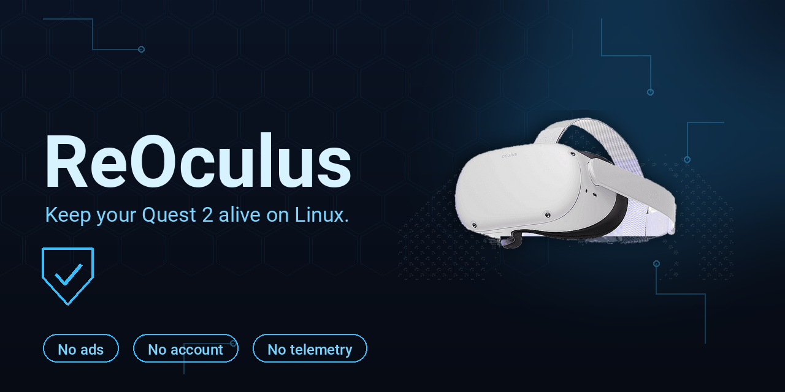

**Your Quest 2, on Linux, without the nonsense. No ads. No account. No telemetry. Nothing leaves your computer.**

ReOculus is a companion app for the Meta Quest 2 (and 3) that replaces the Meta PC app and SideQuest for everyday stuff: manage your apps, back them up, poke around the files, mirror the screen, and run PC VR on Linux with WiVRn. All over USB or Wi-Fi.

Why? Meta is winding down Quest 2 support (last features in Horizon OS v2.13, March 2027, security patches until December 2027). This is my way of keeping the old headset useful on Linux long after that.

> Yes, I used AI to help design and code this. It works on my own Quest 2, every day. If it breaks for you, tell me and we will fix it.

[⬇️ Download](#-download) · [✨ What it does](#-what-it-does) · [📸 Screenshots](#-screenshots) · [🚀 First run](#-first-run) · [🖥️ PC VR](#️-pc-vr) · [🔧 Build it yourself](#-build-it-yourself) · [🙅 What's not in here (yet)](#-whats-not-in-here-yet) · [📋 Status](#-status) · [⚖️ License and credits](#️-license-and-credits)

   

## ✨ What it does

| | Area | What you get |
| --- | --- | --- |
| 📱 | **Apps** | List, search, launch, install (APK/APKS/XAPK), uninstall, force stop, clear data. Real icons and sizes, List or Tiles view. |
| 💾 | **Backups** | Full app backup (APK + data when rooted), save-only backup, one-tap restore from the Library, with a dry run first so nothing surprises you. |
| 📂 | **Files** | Browse the headset storage, upload, download, delete. |
| 🪞 | **Mirror** | Live screen mirror over USB or Wi-Fi (scrcpy, quality picked automatically from the connection). Screenshot and on-device video recording. |
| 🎛️ | **Device** | Battery, storage, firmware, controllers, refresh rate and performance settings. Rooted-only settings live in their own section, out of the way. |
| 🖥️ | **PC VR** | WiVRn 26.9 wrapper: start/stop the server, encoder and codec picker, headset client version check. The server rides along inside the AppImage, and the headset app installs itself on first connect. |
| 📚 | **Library** | One folder on your computer holds every backup and imported APK. |
| 📖 | **Offline help** | The whole help section works with no internet. |

## 📸 Screenshots

Every screen, rendered from the app's own widget tests with Lorem Ipsum placeholder data, so you can see what it looks like without a headset plugged in. No real data in any of them.

### Home

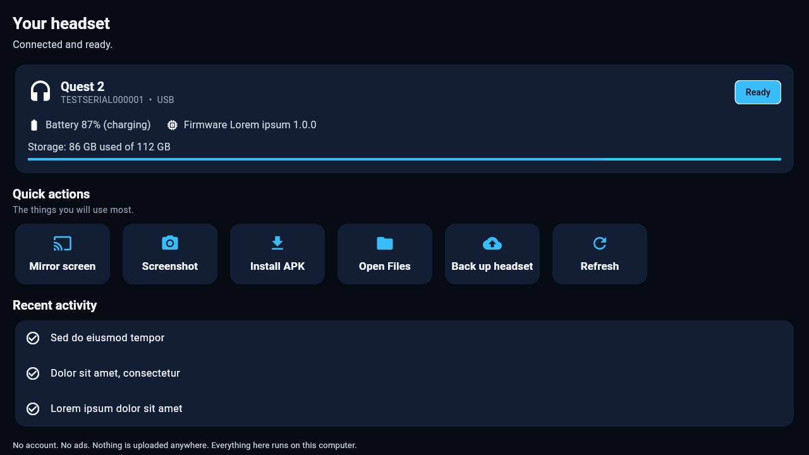

### Devices

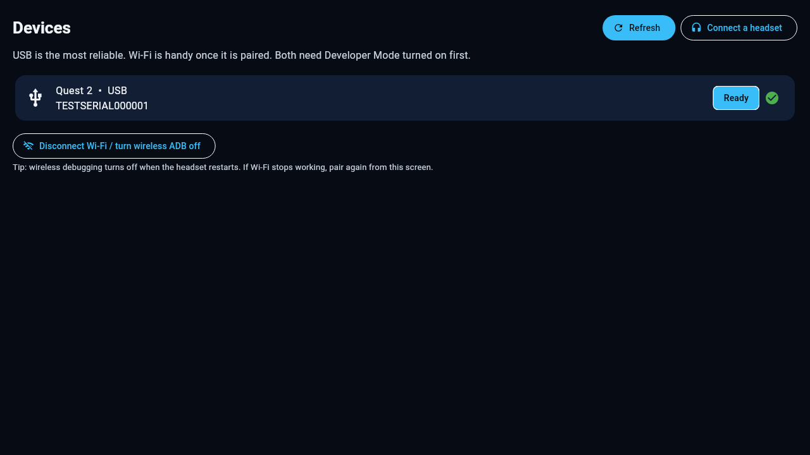

### Apps, list and tiles

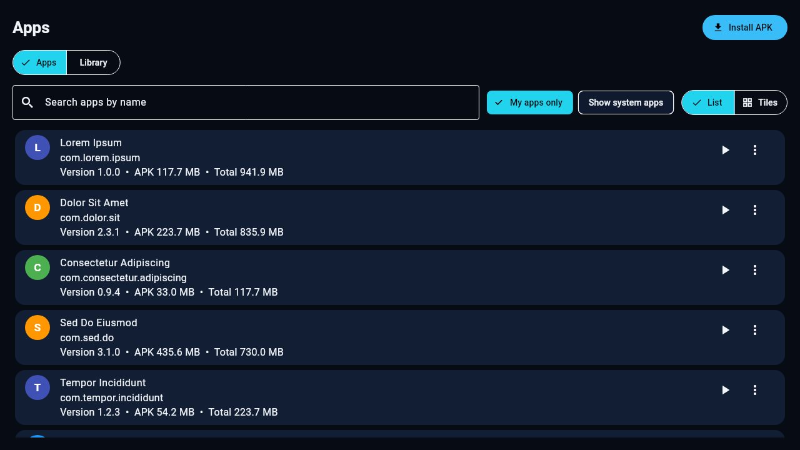

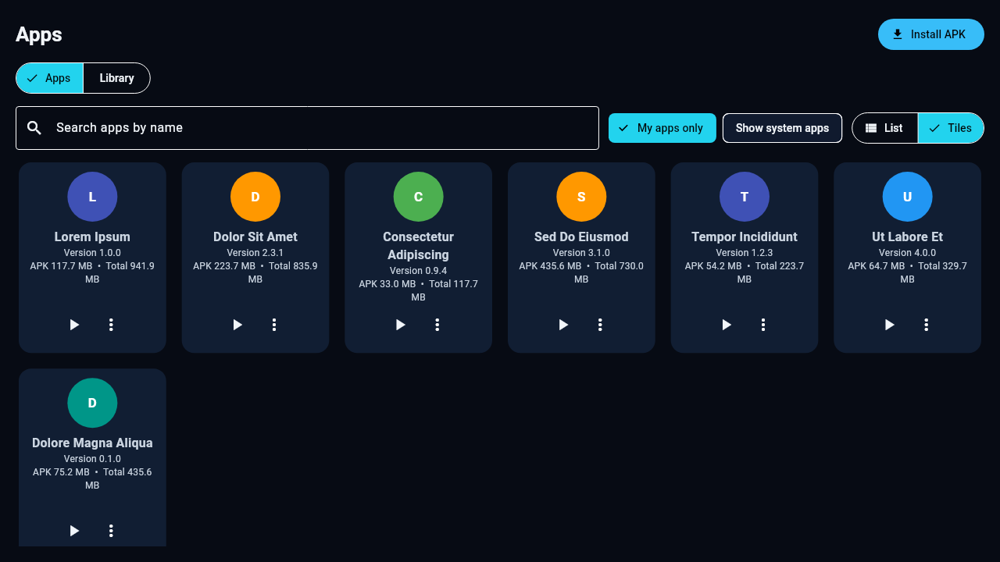

### Files

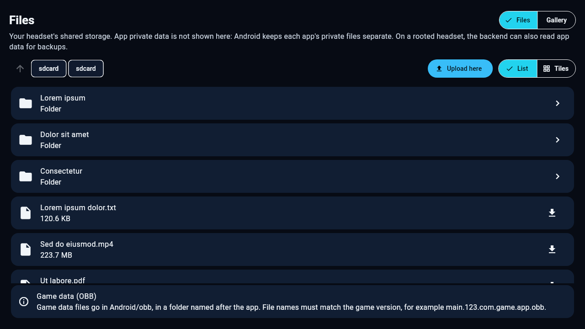

### Device and settings

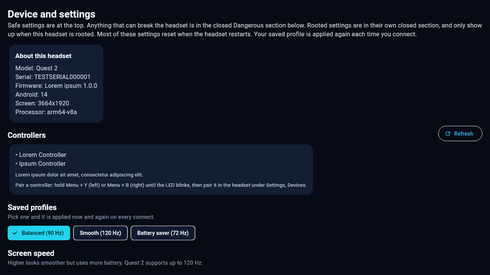

### Mirror

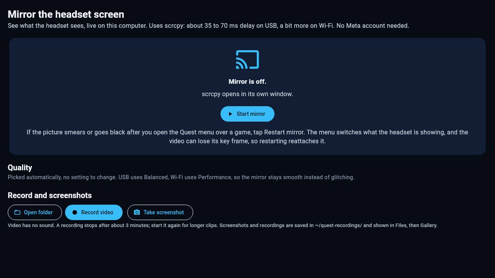

### PC VR (WiVRn)

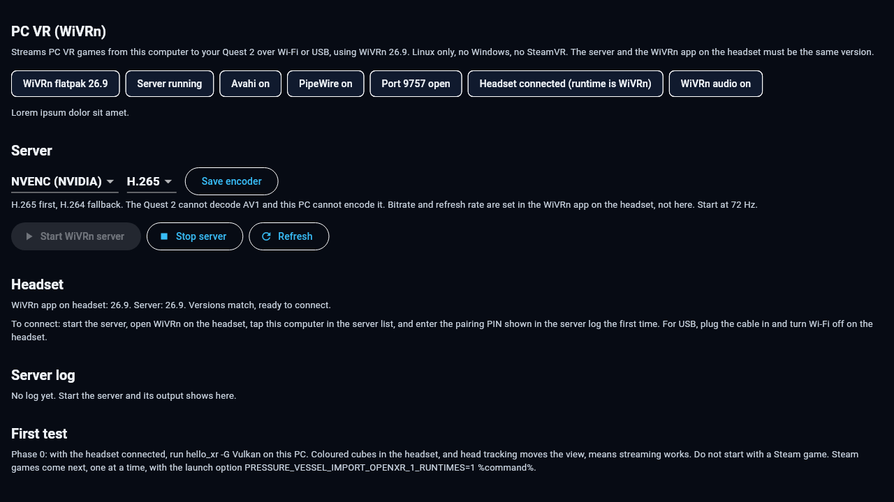

### Logs

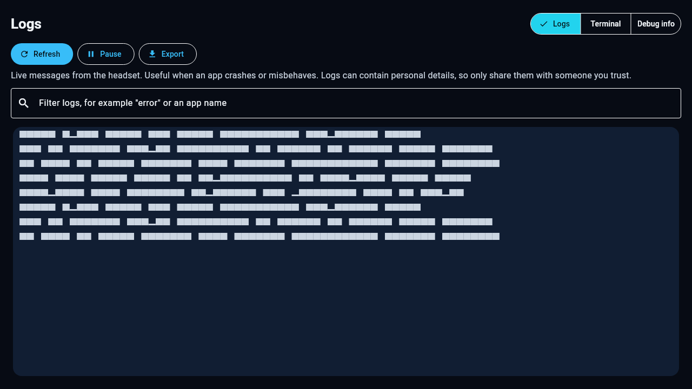

### Help

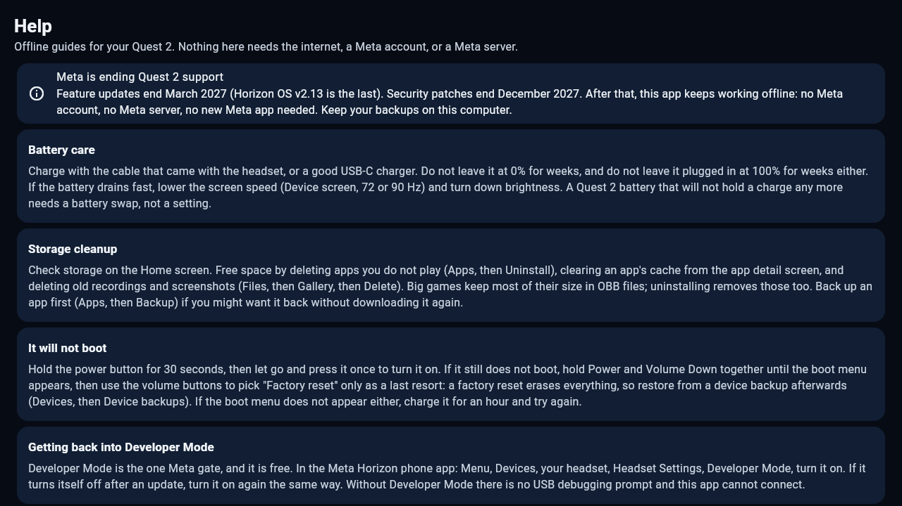

### Setup

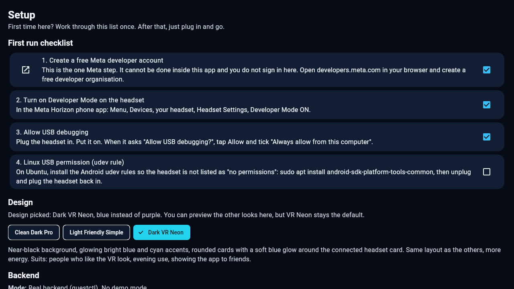

## ⬇️ Download

Grab the latest AppImage from the [Releases](../../releases) page and run it:

```sh
chmod +x ReOculus-*.AppImage
./ReOculus-*.AppImage
```

That is the whole install. The AppImage carries the app **and** the `questctl` backend **and** the WiVRn 26.9 server, so there is nothing else to set up. One note: WiVRn installs through Flatpak on first use, so the PC needs Flatpak. The KDE runtime comes from Flathub the first time if it is not already there.

The Android APK is a full UI preview for now. Headset features on Android are not ready yet, the Rust backend still has to be embedded (see [Android transport](#android-transport)).

## 🚀 First run

1. **Developer Mode on.** Free Meta developer account, flip the toggle in the Meta Horizon phone app. That is the only step that touches Meta at all.
2. **Plug in and connect.** Tap **Connect with USB**, or **Connect with Wi-Fi**. The app sets up wireless ADB itself, so you can unplug after the first USB connection.
3. **PC VR, if you want it.** The first time a headset connects, the app asks about setting up PC VR. It installs the WiVRn server from the bundled file, installs the WiVRn app on the headset, and sets up the USB and Wi-Fi links. After that it is just **Start** on the PC VR screen and tap the computer in the headset app. Say **Not now** and the PC VR section greys out, with an **Install WiVRn** button that reopens the same setup whenever you are ready.

## 🔌 How it works

```
Flutter UI (Linux + Android)
        |
        |  one JSON object per call
        v
questctl  (Rust, quest-core)  --  spawned system adb / libadb DirectTransport
        |
        v
Meta Quest 2 / 3  (USB adb, Wi-Fi adb)
```

- **No Meta APIs, no SideQuest APIs, no account, no network calls** to anyone. The only thing that ever leaves the computer is whatever you explicitly download (the WiVRn APK from GitHub Releases, on first setup).
- **Backend:** Rust workspace in `backend/`, a `quest-core` library plus the `questctl` CLI. Every command prints one JSON object, `{"ok": true, ...}` or `{"ok": false, "error": "..."}`. The exact interface is in [`backend/CONTRACT.md`](backend/CONTRACT.md).
- **UI:** Flutter in `flutter_app/`. Dark VR Neon, blue. Near-black blue background, bright blue accent. Other themes are in the code if you want to play with them.
- **Streaming:** [scrcpy](https://github.com/Genymobile/scrcpy) for the mirror, on-device `screenrecord` for video recording.
- **PC VR:** [WiVRn 26.9](https://github.com/WiVRn/WiVRn), an OpenXR runtime and streamer built on Monado. The app drives the unmodified server (config file + process + `wivrnctl` + polling). It does not fork or embed WiVRn.

## 🖥️ PC VR

Short version: it streams PC VR games from this computer to the headset over Wi-Fi or USB, Linux only, no Windows, no SteamVR. The server and the headset app have to be the same version (26.9), and the app checks that for you and tells you plainly if they do not match.

Start at 72 Hz, H.265, NVENC if you have an NVIDIA card. Bitrate and refresh rate are set in the WiVRn app on the headset, not here, that is where they actually live.

## 🔧 Build it yourself

### Backend

```sh
cd backend
cargo test --release
cargo build --release
```

### Linux app

```sh
cd flutter_app
flutter pub get
flutter build linux --release
```

Package an AppImage with `scripts/build-appimage.sh` (see the script header for paths). It copies the Flutter bundle, `questctl`, and the bundled `wivrn-server.flatpak` into the AppDir. The WiVRn bundle itself is fetched by `scripts/fetch-wivrn.sh` and is not stored in git (about 7 MB of upstream binary).

### Android

```sh
cd flutter_app
flutter build apk --release
```

## 🤖 Android transport

The APK today is the full UI, but headset features do not work on Android yet: there is no `questctl` binary to spawn there. The plan is to bundle `questctl` built for Android aarch64 and use the existing libadb DirectTransport over Wi-Fi. If you know that piece, contributions are very welcome.

## 🙅 What's not in here (yet)

A few things people usually ask about, so let us get them out of the way:

- **No store.** There is no app catalogue and no downloading apps from inside ReOculus. A small curated catalogue plus an update check from GitHub Releases is on the list for later, once there is a proper library database to hang it on.
- **No Beat Saber mods.** Looked into it, parked it. Research only for now.
- **No update blocking by killing `com.oculus.updater`.** Tried it, Android said no, even as root. That package is protected and cannot be disabled, so the app does not pretend otherwise. If you want updates paused, Singularity's own OTA deferral in the headset is the safe way.
- **No messing with your home.** It never writes home settings, never runs Singularity itself, and never touches a setting it cannot undo.

## 📋 Status

**0.2.16** (2026-11-12): the WiVRn first-run card now only appears after the setup check has actually finished and found no client app on the headset. A failed check retries on the next refresh instead of leaving the card stuck up. Setup Backend is read-only (auto-connect). The app is now called ReOculus. See the [Releases](../../releases) page for each version's notes.

## ⚖️ License and credits

This project's own code is **MIT**. See [LICENSE](LICENSE) and [CREDITS.md](CREDITS.md) for the full list: WiVRn (GPLv3, bundled server only), scrcpy (Apache 2.0), SideQuest (reference only, no code used), and the other projects this app is built on or learned from.
